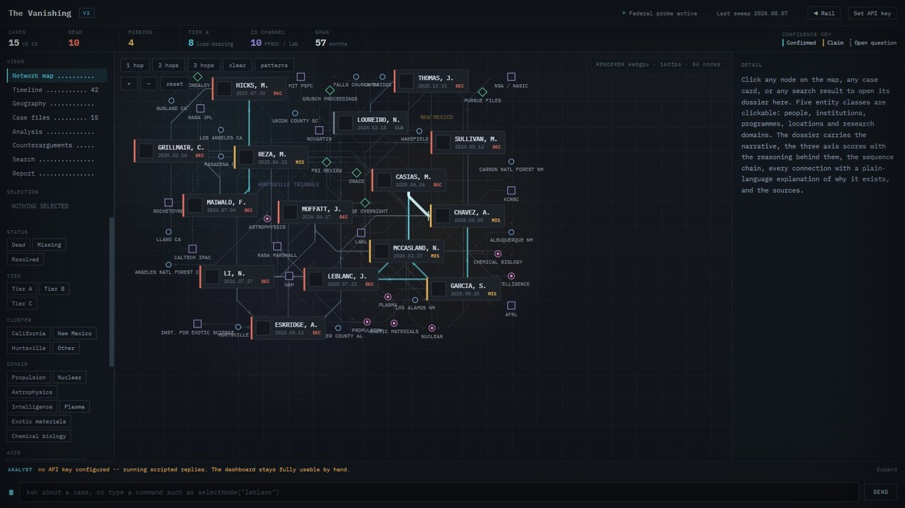
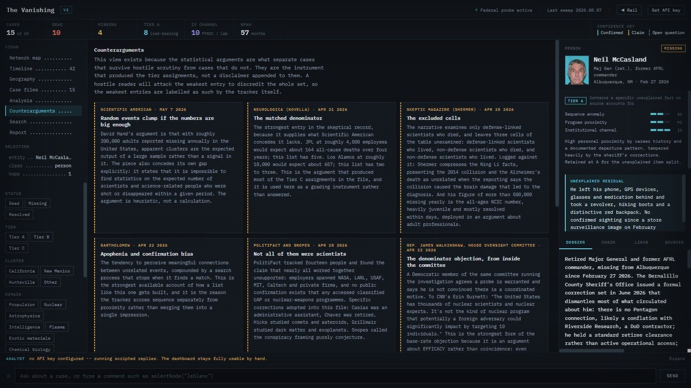

# The Vanishing


An interactive, fully sourced tracker of US scientists and defense-connected people who died or went missing, 2021 to 2026.


**[Open the tracker](https://the-vanishing.pages.dev)** · **[Landing page](https://the-vanishing-landing.pages.dev)** · **[Report a correction](https://github.com/Samizdat-Publications/the-vanishing/issues)**

## How to read this

**Read this before anything else on the board.**

- **Public sources only.** Every case is built from material that was already published: news reporting, official releases, court and agency records, documents released under FOIA, and public statements. Each claim carries its source, and every case links at least one public source you can open and check. Home addresses and private contact details are left out even where reporting printed them.
- **Inclusion is not a claim of foul play.** A name on this board means the death or disappearance was publicly reported and fits the tracker's scope. It does not mean anyone was harmed by anyone. Five of the fifteen cases (Tier C) have a conventional explanation that holds, and they are labelled that way on purpose.
- **Fact, claim and open question are kept apart.** The confidence key on every page marks what is confirmed, what is only alleged, and what nobody knows. Skeptical reporting and counterarguments are carried in full, not trimmed.
- **These are real people.** Several families have publicly asked that their losses not be treated as conspiracy material. Where they have spoken, the tracker records what they said accurately and does not argue with it.
- **Corrections are welcome.** If something is wrong, out of date or should not be here, [open an issue](https://github.com/Samizdat-Publications/the-vanishing/issues) with the case name, what is wrong, and a public source if you have one. Requests from family members are handled first.

## What it is

The Vanishing tracks fifteen cases: ten deaths, four people still missing and one case resolved, between July 2021 and 2026. Many were named in the April 2026 House Oversight letters and the federal review that followed. It is a single-page app with a network map, a timeline, a geography view, case files, a counterarguments view and a report. Clicking any person, institution, programme or place opens its dossier: narrative, chronology, the three axis scores with their reasoning, every connection with a plain-language explanation of why it exists, and the sources.

The analytical idea is that **an event prosaic in isolation may not be prosaic in sequence**. The tracker reconstructs those sequences from the record and then grades them against the strongest skeptical reading it can find. It starts from the working hypothesis that a pattern may exist, and is built so that a hostile reader can check every link.

An optional analyst panel answers questions about the case file if you paste your own Anthropic API key. The key stays in your browser and goes only to api.anthropic.com. Without a key everything still works by hand.

## Screenshots

| | |
|---|---|
|  |  |

## Scoring

Three axes, 0 to 3, **never summed.** A case can be extraordinary on one axis and wholly unremarkable on another, and collapsing that into one number destroys the information.

| Axis | Question |
|---|---|
| **S** Sequence anomaly | How many independently documented, individually unexplained links form a chain? |
| **P** Personal program proximity | What sensitive access did this person personally hold? |
| **I** Institutional channel | Does the employer have documented history as a conduit for classified work? |

Tier A requires an unexplained fact that no published source accounts for, **plus** S2 or higher, or P3, or I3.

## Sources

The full source list for each case is on its dossier (Sources tab) and in [`research/cases.json`](research/cases.json). Across the fifteen cases the record cites 43 distinct linked sources, among them:

| Kind | Examples |
|---|---|
| News reporting | CNN, Los Angeles Times, NBC News, Boston Globe, Santa Fe New Mexican, LA Magazine, Newsweek, Fox News, NewsNation, Pasadena Now |
| Fact checks | PolitiFact |
| Official and agency records | House Oversight Committee letters (20 April 2026), House committee repository, LA County District Attorney releases, New Mexico DPS missing persons records, Alabama Secretary of State, af.mil biographies, USAspending |
| Released documents | Defense Intelligence Reference Documents released under FOIA (via The Black Vault), patent records |
| Skeptical literature | Scientific American, Skeptic, NeuroLogica, Snopes, PolitiFact (used to grade cases, see the Counterarguments view) |

Some claims cite a named outlet or record without a link, and a few rest on a single secondhand report. Those are marked with their confidence tier on the board, and the case-level sources always link.

## How it was made

The dashboard is **built from data, not edited by hand.** Case records, entities, the timeline and the graph live in [`research/`](research/) as JSON. `tools/merge.py` assembles them, `tools/build_dashboard.py` renders the single HTML page, and `tools/verify.py` runs the gates that define "shippable": schema checks, a semantic diff against a frozen baseline so no claim can be removed or changed without a declared reason, and discovery checks that flag gaps, contested claims and sources that only repeat each other. Every gate is itself tested against input it must reject (`--self-test`).

Plain HTML, CSS and JavaScript in one file, with a WebGPU renderer for the map's connection lines (WebGL2 and Canvas 2D fallbacks). Python for the build and checks. The research method is documented in [`RESEARCH-PROCESS.md`](RESEARCH-PROCESS.md) and [`DISCOVERY-PROTOCOL.md`](DISCOVERY-PROTOCOL.md).

## Run it locally

Needs Python 3. The commands work in PowerShell and in bash.

```
git clone https://github.com/Samizdat-Publications/the-vanishing.git
cd the-vanishing
python tools/merge.py; python tools/build_dashboard.py; python tools/verify.py --idempotent
python -m http.server 8971
```

Then open `http://127.0.0.1:8971/dist/the-vanishing.html`. Opening the file directly (`file://`) does not work, because the page loads its photographs by relative path.

To publish: `python tools/build_site.py` assembles `site-dist/`, which deploys to Cloudflare Pages with `npx --yes wrangler@4 pages deploy site-dist --project-name the-vanishing --branch master` (the project's production branch is `master`; `--branch main` publishes only a preview). The landing page source is in `site/`.

## Files

| File | Purpose |
|---|---|
| `research/*.json` | The case data. The source of truth. |
| `tools/` | Build, merge and verification scripts. |
| `PROJECT.md` | Master documentation: cases, institutions, clusters, analysis threads, counterarguments, sources. |
| `RESEARCH-PROCESS.md`, `DISCOVERY-PROTOCOL.md` | How cases are found, sourced and scored. |
| `SCORING-DISCREPANCIES.md` | Axis conflicts and how they were adjudicated. |
| `PHOTOS.md` | Per-image provenance and licence research. |
| `LEADS.md`, `notes/` | Unverified leads and research notes. Leads are not findings. |
| `the-vanishing-v2.html` | Frozen historical reference the data was extracted from. Not the build target. |
| `scientist-network-tracker.html` | v1. Superseded, kept for reference. |

## Credits

| What | Who | Licence |
|---|---|---|
| Photographs of the fifteen people | Credited individually on each dossier and in [`PHOTOS.md`](PHOTOS.md): police and sheriff's departments via New Mexico DPS, Wakefield Police Department, Caltech IPAC, University of Arizona LPL, UAH, family obituary photographs (Legacy.com, Dignity Memorial), Wikimedia Commons | Each keeps its own terms; most are **not** public domain. Nuno Loureiro's portrait is CC BY-SA 4.0 (Wikimedia Commons). |
| IBM Plex Mono | IBM, via Google Fonts | SIL Open Font License 1.1 |
| Reporting and records | The outlets and agencies listed under Sources | Cited and linked, not reproduced |

## Licence

Code is MIT (see [LICENSE](LICENSE)). The photographs and third-party material listed above keep their own licences and are not covered by it.

## Not to be confused with

**The Legacy Program Dashboard**, a companion board on a different subject. It shares this project's engine, schema and design system and uses `the-vanishing-v2.html` as a frozen build input. The two overlap at exactly one person, Amy Eskridge. They are not merged.
